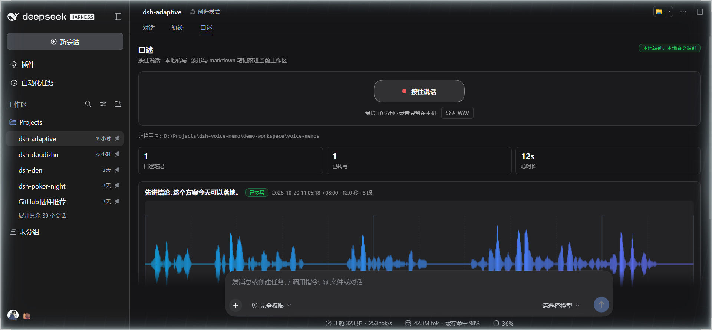
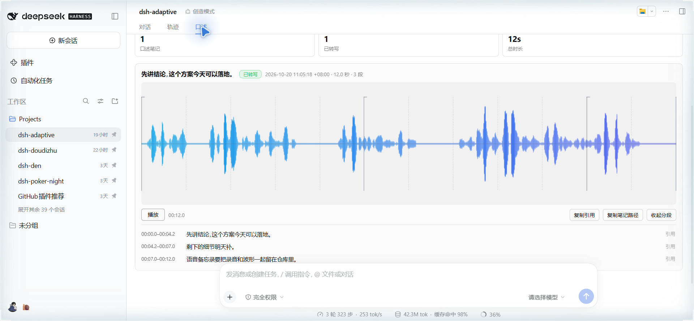
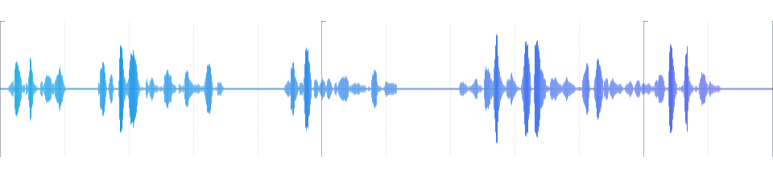

# dsh-voice-memo

[](https://github.com/dingchenhui0618-arch/dsh-voice-memo/actions/workflows/ci.yml)
[](LICENSE)

> 按住说话录一段，本地转写出带时间戳的分段文本，生成一张波形图和一个 markdown 笔记落到仓库里 —— 可回听、可引用、可进交付文档。

DeepSeek Harness（DSH）插件。给会话加一个「口述」Tab：录完的每一段都变成工作区里**可归档、可引用、带视觉证据**的一条笔记，而不是只在聊天里闪一下的转写结果。

> 用着还行的话，点个 ⭐ 就够了——插件市场的「搜插件」按 GitHub star 排序，star 是这个插件能被人翻到的唯一杠杆。

安全模型——录音写到哪个目录、转写什么时候真的在本地、音频会不会进模型上下文：
[SECURITY.md](SECURITY.md)。





> 截图来自真实运行：dsh web + 本插件 + 本机 faster-whisper，录音是一段 TTS 生成的中文语音（12.0 秒、3 个分段），从面板「导入 WAV」走完解码 → 重采样 → 编码 → 转写 → 归档整条链路。没有使用任何静态 mock。

## 为什么做这个

DSH 已有的语音插件基本停在「说一句、听一句、做一次健康检查」：TTS 朗读、ASR 单次识别、语音输入法。**没有一个是把口述当成资料来归档的** —— 录音留在临时目录、转写没有时间戳、更没有波形图和 markdown 笔记。

这个插件补的是最后一公里：

- **录音留在工作区**：`voice-memos/<id>/audio.wav`，不是 `~/.dsh` 临时文件，能随项目一起提交、备份、换机器。
- **每个分段都有时间戳**：`00:01.2–00:03.4`，笔记里带 `#seg-N` 锚点，引用时能指回原话的那几秒。
- **波形图是证据**：`waveform.png` 由同一份采样渲染，透明背景，贴进 README / 交付文档不挑主题。
- **不联网**：识别走本机 `speechToText` 服务或本机命令；引擎没配好就如实标「未转写」，绝不编一段假文本。

## 它挡住什么

| 常见做法 | 这里的不同 |
| --- | --- |
| 口述完只看聊天里的一次输出 | 落盘成 `audio.wav` + `waveform.png` + `memo.md` + `meta.json`，会话结束还在 |
| 转写没有时间戳，回头找不到原话 | 每个分段时间戳 + `#seg-N` 锚点 + 可直接粘贴的引用块 |
| 录音传到云端服务 | 默认只用本机引擎；引擎不可用时状态如实标注，不伪造转写 |
| 波形图要装 ffmpeg / matplotlib | 纯 JS 编码 PNG（`node:zlib` + CRC32），零依赖 |
| 只在面板里可见 | `voice_memo_save/list/read` 三个工具让 agent 也能归档与引用；同一份归档两边共用 |

## 安装

```bash
# 从 GitHub 装（仓库自带构建好的 lib/，不需要构建）
dsh plugin --profile <profile> add github:dingchenhui0618-arch/dsh-voice-memo
```

本地开发时直接 link：

```bash
dsh plugin --profile <profile> add link:D:\Projects\dsh-voice-memo
```

安装后重载 DSH。会话视图里会多出「口述」Tab。

## 面板与截图

上面两张就是真实运行界面（1920×889，深色 / 浅色）。「口述」Tab 做四件事：

1. 按住「按住说话」录音，松开结束；录音时显示电平和秒数。也可以「导入 WAV」。
2. 浏览器用 Web Audio 解码、混成单声道、重采样到 16 kHz、编码成规范 WAV（PCM16），再 POST 给 Host —— Host 不需要音频解码器。
3. Host 调本地识别引擎，生成 `audio.wav`、`waveform.png`、`memo.md`、`meta.json`。
4. 面板列出归档：波形可点击定位、音频可回听、分段可逐条复制引用、笔记路径一键复制。

## 归档长什么样

```
<当前会话工作区>/voice-memos/
  20261020-104532-ab12/
    audio.wav       16 kHz 单声道 PCM16，规范格式
    waveform.png    960×220 透明背景波形 + 时间刻度
    memo.md         frontmatter + 元信息表 + 带锚点分段 + 引用块
    meta.json       面板与工具读取的机器可读记录
```

`memo.md` 的分段形如：

```markdown
<a id="seg-1"></a>

### 00:00.0–00:02.4

先讲结论：这个方案今天可以落地。
```

引用块可以直接粘进交付文档：

```markdown
> 先讲结论：这个方案今天可以落地。
> —— 口述笔记 2026-10-20 10:45:32 +08:00 · 00:00.0–00:02.4
>
> 笔记：`D:\Projects\demo\voice-memos\20261020-104532-ab12\memo.md#seg-1`
```

## 配置

插件在 `cordis.patch.yml` 里以 `dsh-voice-memo` 注册。可用配置项（profile 的插件 Config）：

```yaml
dsh-voice-memo:
  outputDir: voice-memos      # 相对工作区，或绝对路径
  language: zh                # 识别语言提示
  maxDurationSec: 600         # 单条录音上限
  maxAudioBytes: 20971520     # 音频大小上限
  asr:
    mode: auto                # auto | harness | command | off
    command: null             # 例：["D:\\path\\.venv\\Scripts\\python.exe", "D:\\Projects\\dsh-voice-memo\\workers\\transcribe_faster_whisper.py", "--model", "small"]
    providerId: null          # harness 模式下指定 speechToText provider
    timeoutSec: 120
```

### 识别引擎

- **harness**：用 DSH 的 `speechToText` 服务（随实验性语音输入插件提供）。服务只接收整段录音，所以插件按静音切窗口（RMS + 噪声底），逐窗转写并把窗口边界写成时间戳。目前桌面 profile 未加载该实验插件时这条路径不可用，面板会显示「未配置本地识别引擎」。
- **command**：任意本地命令，约定是「最后一个参数是 16 kHz 单声道 WAV 路径，stdout 打印一个 JSON 对象」：

  ```json
  {"engine":"faster-whisper","model":"small","language":"zh",
   "segments":[{"start":0.0,"end":2.4,"text":"……"}],"text":"……"}
  ```

  仓库自带 `workers/transcribe_faster_whisper.py` 作为参考实现。它需要本机装 `faster-whisper`（插件不会替你装）：

  ```bash
  python -m venv .venv
  .venv\Scripts\pip install faster-whisper
  ```

- **auto**：有 harness 用 harness，否则用 command，都没有就明确报「未配置」。
- **off**：只归档音频与波形，笔记标「未转写」。

任何引擎失败都只影响 `status` 与 `reason` 字段：录音、波形、笔记照常落盘。

## Agent 工具

| 工具 | 作用 |
| --- | --- |
| `voice_memo_save` | 把一段 WAV（路径或 base64）归档成口述笔记，返回笔记/音频/波形路径与引用行 |
| `voice_memo_list` | 列出当前工作区归档：时间、时长、段数、状态、笔记路径 |
| `voice_memo_read` | 读取一条笔记的完整 markdown、分段与引用行 |

典型用法：用户说「把这个录音整理成笔记」，agent 调 `voice_memo_save`；写交付文档时调 `voice_memo_read` 取带时间戳的引用。

## HTTP API

面板与 Host 之间的接口（都在 `/dsh-voice-memo` 前缀下）：

- `GET /api/state?sessionId=` —— 归档列表、引擎状态、上限
- `POST /api/save` —— `{audioBase64, sessionId, title?, language?}`
- `POST /api/read` —— `{id, sessionId}`
- `GET /audio/<id>?sessionId=`、`GET /wave/<id>`、`GET /note/<id>`

## 开发

```bash
node scripts/build.mjs      # 生成 lib/index.js 与 lib/client.js
node --test test/*.test.mjs # 全部测试
```

- `lib/` 是提交进仓库的构建产物，`dsh plugin add github:…` 直接可用。
- Host 半是零依赖 ESM；客户端半由 `scripts/build.mjs` 把 CSS 与共享的 `src/pcm.cjs` 内联进 `window.__ModuleLoader__` bundle。
- `node --test` 覆盖：WAV 解析/编码/重采样、PNG 结构与波形渲染、笔记渲染、两种转写引擎（含失败与超时）、归档存储、HTTP 路由与工具、构建产物。

## 本次验证

| 项目 | 结果 |
| --- | --- |
| `node --test test/*.test.mjs` | 52 个测试全部通过（0 失败） |
| `node scripts/build.mjs` | 产出 `lib/index.js`（21,408 B）与 `lib/client.js`（42,209 B） |
| 真实运行 | `web` profile + 本插件 + 本机 faster-whisper（small），从面板「导入 WAV」归档了一条 12.0 秒中文录音 |
| 归档结果 | `audio.wav` 384,204 B / `waveform.png` 15,339 B / `memo.md` 1,516 B / `meta.json`，3 个带时间戳分段 |
| 转写文本 | 「先讲结论,这个方案今天可以落地。」「剩下的细节明天补。」「语音备忘录要把录音和波形一起留在仓库里。」 |
| 截图 | `docs/screenshot-dark.png`、`docs/screenshot-light.png`，由 WebBridge 操作真实浏览器截取 |
| 波形示例 | `docs/waveform-example.png`（同一条录音的产物，透明背景） |

真实运行时用的录音是 `System.Speech`（Microsoft Huihui，zh-CN）合成的 WAV，用来替代「真人对着麦克风说话」这一步；面板侧的 `getUserMedia` / `MediaRecorder` 采集路径无法在无头环境自动化，见下面的已知边界。



## 参考与差异

做之前查过同类插件，结论是**没有覆盖这条链路**：

- [PerryLink/dsh-talk](https://github.com/PerryLink/dsh-talk)（Apache-2.0）：浏览器 Web Speech / FunASR / whisper.cpp 的 STT + TTS；录音存在 `~/.dsh-talk/audio`，明确不进工作区；没有时间戳、波形和 markdown 笔记。
- [STARDUSTLC666/dsh-voice](https://github.com/STARDUSTLC666/dsh-voice)（MIT）：Edge TTS + OpenAI 兼容 ASR，单文件实现；没有时间戳、波形和笔记归档。
- [huliux/dsh-asr-plugin](https://github.com/huliux/dsh-asr-plugin)：macOS arm64 本地模型，有时间戳与说话人标签；模型约 278 MiB，没有波形图，也没有「笔记落进仓库」。
- [Jesse-njx/dsh-voice](https://github.com/Jesse-njx/dsh-voice)：语音备忘录存 `~/.dsh/voice`；没有时间戳、波形和笔记。
- [YLL-KB/dsh-video-to-notes](https://github.com/YLL-KB/dsh-video-to-notes)：视频 → ffmpeg + Whisper → 结构化笔记；没有波形图，也不是「按住说话」的即时口述。

本项目的差异：**口述 → 时间戳分段 → 波形 PNG → 仓库内 markdown 笔记**这一整条链路，加上 agent 工具与面板共用同一份归档。实现是独立写的，没有 fork 或复制上述仓库的代码；仅参考了 DSH 自身的 slot / route / tool 约定（与 `dsh-warden` 的骨架结构）。

## 已知边界

- **麦克风采集没有端到端自动化**：`getUserMedia` 的授权弹窗必须由真人点按，无法在无头环境复现。面板的「导入 WAV」路径与本条链路共用同一段解码/重采样/编码/上传代码，且已真实跑通；`MediaRecorder` 采集本身只做了代码审查，没有自动化证据。
- **`harness` 引擎只做了单测**：stub `speechToText` 覆盖了窗口切分、provider 解析与失败传播；本机桌面 profile 未加载实验性语音输入插件，因此没有在这条路径上跑过真机识别。`command` 引擎用本机 faster-whisper 实测（见上表）。
- **波形图是振幅包络 + 时间刻度**，不做频谱；口述用途够用，不是音频分析工具。
- **口述笔记默认落在工作区**：`voice-memos/` 是你自己的资料目录，本仓库的 `.gitignore` 只是避免开发时误提交；要不要把某个 `voice-memos/` 提交进你的项目，由你决定。
- 演示用的 12 秒语音与归档目录（`demo-workspace/`）没有提交进仓库，因为它们是本机验证产物；仓库只保留可复现的测试、截图与波形示例。

## License

MIT
